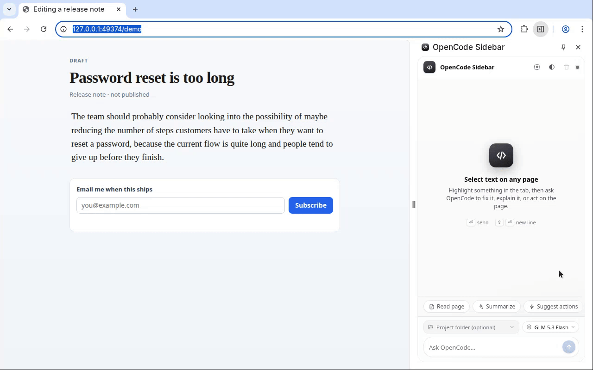
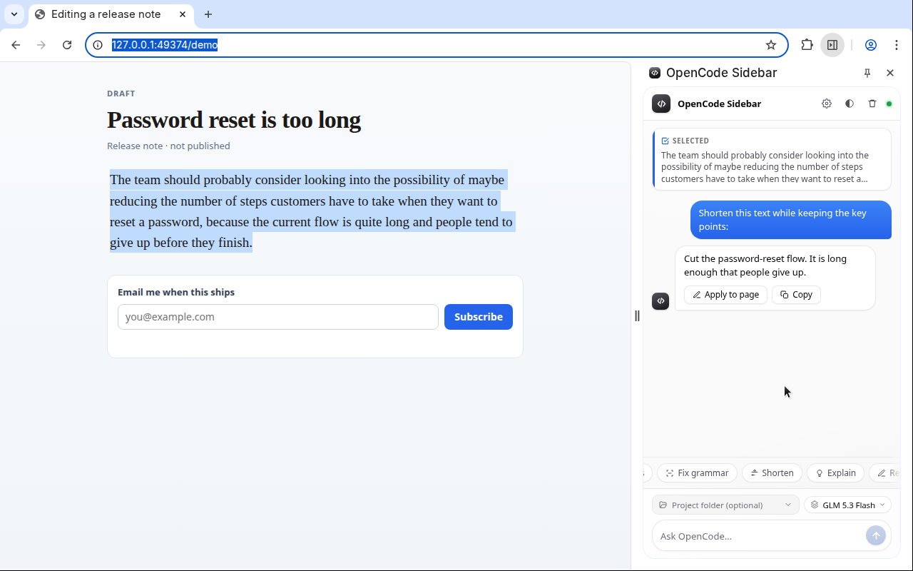
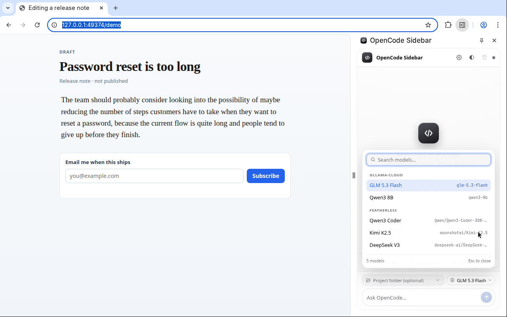
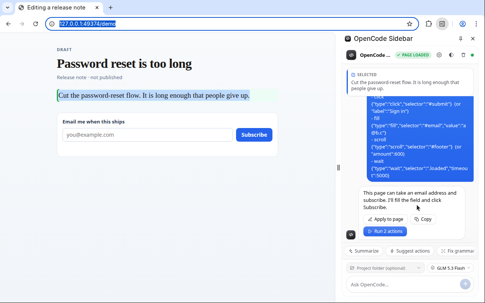

# OpenCode Sidebar

A Chrome side panel that puts a local [OpenCode](https://opencode.ai) server next to the page you are reading. Highlight text, ask for a fix, and write the answer back into the page.



Version 0.3.0

## What it does

- Watches the text you highlight and keeps it next to the conversation
- One-click **Fix grammar**, **Shorten**, **Explain**, **Rewrite**, and **Summarize**
- **Read page** pulls the page text, links, and form fields into the chat
- **Suggest actions** asks OpenCode for clicks, fills, and navigation, then **Run N actions** performs them after you confirm
- **Apply to page** replaces the original selection with the reply
- **Model picker** lists every model the server exposes, searchable and grouped by provider
- **Project folder** picker so OpenCode works in a real directory on that machine

## Requirements

- Chrome, or another Chromium browser with Manifest V3 side panels
- [OpenCode](https://opencode.ai) **v2**. The extension speaks the v2 HTTP API (checked against OpenCode 2.0.27): Basic auth, username `opencode`, and the session / model / prompt endpoints under `/api`
- A browser-control tool in that OpenCode server (MCP or skill). Required for **Suggest actions** and **Run N actions**
- Node.js only if you want the mock server below. The extension itself has no build step

## Install

1. Clone this repository
2. Open `chrome://extensions`
3. Turn on **Developer mode**
4. Click **Load unpacked** and choose this folder (the one that contains `manifest.json`)
5. Click the extension's toolbar icon to open the side panel. On a page that was already open, reload it once so the selection watcher is injected

## Setup

The panel talks to OpenCode on your machine. Nothing in the extension starts the server for you.

**Foreground server.** `opencode serve` listens on `127.0.0.1`. Set a password with `OPENCODE_PASSWORD` (the username is always `opencode`):

```bash
OPENCODE_PASSWORD="a-long-secret" opencode serve --port 49374
```

**Background service.** The same API, managed by OpenCode. `opencode service status` prints the address. Pin a port and a password, then start it (`service set` stops the running service):

```bash
opencode service set port 49374
opencode service set password "a-long-secret"
opencode service start
```

A fresh service password changes when the background service restarts. Pinning the port and password, as above, keeps the panel connected. The extension's default port is `49374`, which is the `latest` channel. Auto-detect also tries `49375` (`local`) and `4096` (the older `opencode serve` default).

In the panel, open the gear icon:

1. Host `127.0.0.1`, the port you chose, username `opencode`, and the password
2. **Save**, then **Test**. A good connection reports `Connected to http://127.0.0.1:49374/api`
3. Or **Pick config folder…** and choose `~/.config/opencode` or `~/.local/state/opencode`. The extension reads `service.json` from that folder and fills in the password. To copy it yourself: `cat ~/.config/opencode/service.json`
4. **Auto-detect** tries the current settings, those service files (Chrome has to allow file URLs), the ports above, and `opencode.local`

The model chip fills in from `GET /api/model` once the password is accepted. Pick a model there, or press `Ctrl+K` / `Cmd+K`.

## Browser control (required for page actions)

The extension does not name a skill, MCP server, or agent. **Suggest actions** still asks your OpenCode server for clicks, fills, and navigation, so that server needs a browser-control tool of its own. Highlight, rewrite, and **Apply to page** do not.

Playwright MCP is the usual one. Put this in `~/.config/opencode/opencode.json`, or in a project `opencode.json`. On v2, servers live under `mcp.servers`:

```json
{
  "$schema": "https://opencode.ai/config.json",
  "mcp": {
    "servers": {
      "playwright": {
        "type": "local",
        "command": ["npx", "-y", "@playwright/mcp"]
      }
    }
  }
}
```

Restart OpenCode. `opencode mcp list` should show `playwright` connected.

Chrome DevTools MCP uses the same block. Name the server `chrome-devtools` and set `command` to `["npx", "-y", "chrome-devtools-mcp@latest", "--autoConnect"]`. Turn on remote debugging at `chrome://inspect/#remote-debugging` first.

Or install OpenCode's browser plugin, which registers the `browser` skill (mention it as `@browser`):

```bash
opencode plugin add @opencode-ai/browser-control
```

A skill you add yourself is a `SKILL.md` file at `~/.config/opencode/skills/<name>/SKILL.md`, or `.opencode/skills/<name>/SKILL.md` in a project.

## Try the UI without a model

`scripts/mock-opencode-server.js` is a small Node server with no dependencies. It implements only the endpoints this extension calls and returns canned replies, including a short streamed poll before the message is marked finished. Use it to click through the panel. It is not a model.

```bash
node scripts/mock-opencode-server.js
```

It listens on `http://127.0.0.1:49374`. Sign in as username `opencode`, password `demo` (override with `MOCK_OPENCODE_PORT` and `MOCK_OPENCODE_PASSWORD`). Open `http://127.0.0.1:49374/demo` and use the panel against that page. The recording above was made this way.

## Usage

Highlight a paragraph. The panel keeps the selection. **Shorten** (or Fix, Explain, Rewrite) sends it to OpenCode. **Apply to page** writes the reply back over the original text. **Copy** puts it on the clipboard.



The model list is every model that server is offering, grouped by provider.



**Read page** stores the current tab for this conversation. **Summarize** and **Suggest actions** read the page first. Suggested actions come back as a short note plus a JSON block. The JSON is hidden in the bubble. **Run N actions** performs them on the active tab, one at a time, and reports each result. You can also type your own prompt. Enter sends, Shift+Enter inserts a line.



The optional project folder is a path on the machine running OpenCode, such as `~/projects/my-app`. Leave it empty to use the server's working directory. The folder list comes from OpenCode's own filesystem API, so the extension does not ask for extra disk permissions.

## Using open models via Featherless

Optional. OpenCode can call [Featherless](https://featherless.ai) as an OpenAI-compatible provider. Put this in `opencode.json` (the project file, or `~/.config/opencode/opencode.json`):

```json
{
  "$schema": "https://opencode.ai/config.json",
  "provider": {
    "featherless": {
      "npm": "@ai-sdk/openai-compatible",
      "name": "Featherless",
      "options": {
        "baseURL": "https://api.featherless.ai/v1",
        "apiKey": "{env:FEATHERLESS_API_KEY}"
      },
      "models": {
        "Qwen/Qwen3-Coder-30B-A3B": {
          "name": "Qwen3 Coder"
        }
      }
    }
  }
}
```

Export `FEATHERLESS_API_KEY` in the environment of `opencode serve`. The background service does not inherit your shell, so pass it with `opencode service set env FEATHERLESS_API_KEY <your-key>` and start the service again. Then choose the model in the panel.

## Permissions

| Permission | Why |
|---|---|
| `sidePanel` | The UI lives in Chrome's side panel |
| `storage` | Host, port, password, model, and recent folders stay in `chrome.storage.local` |
| `tabs`, `activeTab`, `scripting` | Read the selection, read the page, apply text, and run clicks and fills on the active tab |
| Host access to all sites | The content script has to see highlights on whatever tab you are using, and page actions have to run there. The service worker also needs it to call your OpenCode server |

The extension does not phone home. All-sites access is what lets it work on the page you already have open.

## Privacy

Settings, including the password, stay in the browser. Requests go only to the host and port you configured, as HTTP Basic auth, default `127.0.0.1`. The highlighted text is sent when you ask about it. Page text is sent when you click **Read page**, or when the prompt is about the page (**Summarize**, **Suggest actions**, or a message that refers to the page). No analytics, and no account with this extension.

If you point OpenCode at Featherless or another provider, that traffic is between OpenCode and the provider. This extension never sees the API key.

## Troubleshooting

- **Could not reach the server** or **Failed to fetch**. Nothing is listening, or the port is wrong. Check `opencode service status`. The panel defaults to `127.0.0.1:49374`. Auto-detect also tries `49375` and `4096`.
- **Wrong username or password**, or a **401**. The username is `opencode`. The password is `OPENCODE_PASSWORD` for `opencode serve`, or the `password` field in `service.json` for the background service. The gear menu opens on its own after an auth failure. Save, then Test.
- **CORS or Failed to fetch when the process is clearly running.** Chrome uses the same message for a refused connection and a blocked origin. This extension's service worker is allowed to call the host you configured. A server that allowlists browser origins can still refuse one. For OpenCode, add the origin with `opencode serve --cors <origin>` or `opencode service set cors <origin>`, then start the service again. Confirm the host is `127.0.0.1` and not only a public name.
- **Suggest actions** never proposes clicks, or OpenCode says it cannot use a browser. No browser-control MCP or skill is loaded. Add the `playwright` server under `mcp.servers` (see above) or install the `browser` skill, then restart OpenCode. `opencode mcp list` shows whether the server connected.
- **Project folder not found.** The directory has to exist on the machine running OpenCode. A path from another computer will not. Clear the field to use the server's working directory.
- **Cannot read browser pages**, or **Could not apply**. `chrome://` pages and the extensions page cannot be scripted. Reload a normal `http` or `https` tab. Apply only works when the highlighted text is still in the page as one stretch of text.

## Contributing

Issues and pull requests are welcome. The panel is plain JavaScript: `manifest.json`, `background.js`, `sidepanel.html`, `sidepanel.js`, and `selection-capture.js`. There is no build.

```bash
node scripts/check-version.js
```

That checks the README still mentions the version in `manifest.json`.

To re-record the GIF and screenshots (Playwright, a local mock server, and `ffmpeg`):

```bash
npm install
npx playwright install chromium
node scripts/record-demo.js
```

## License

[MIT](LICENSE)
